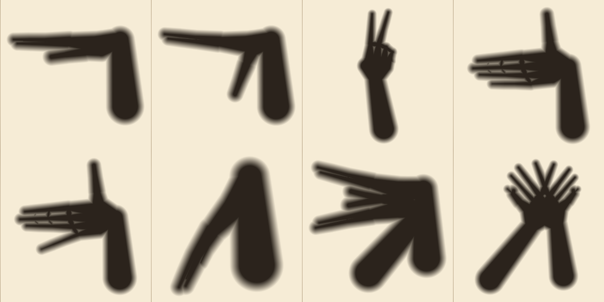
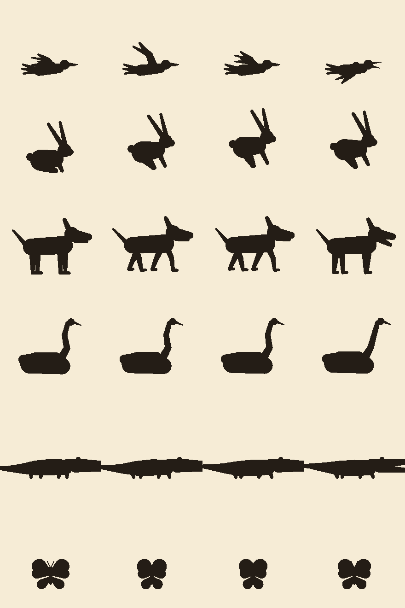

# Shadowplay

**Your wall becomes a shadow theatre, and a lantern tells you a story.** A lantern glows over your shoulder; your hands cast soft shadows on the real wall in front of you. Shape the shadow until it matches, and it wakes up: a bird that chirps when you open its beak, a rabbit that hops away, a dog that barks when you drop your little finger. Then the Lantern improvises a bedtime story, and your hands cast it. Whatever creature you make walks into the tale.

Shadowplay is a hands-first, seated mixed-reality game for Meta Quest, built on the web with Meta's Immersive Web SDK (WebXR). It needs no controllers, no store install and no account. Open the link and play.

- **Play on Quest:** open **https://pswapnajit.github.io/shadowplay/** in Meta Quest Browser and press *Enter the theatre*. Sit facing a wall about 1–3 m away.
- **Play on a laptop:** open the same link in Chrome and press *Try with your webcam*. Hand tracking runs in the browser, and the screen becomes the wall.



## How a session goes

1. **The lantern arrives.** A small light appears in front of you, glides over your shoulder, and your wall lights up in a warm pool. The rest of the room dims.
2. **A golden ghost hand shows you the first shape.** You copy it, and your shadow appears on the wall: your real wall, found with scene understanding. The outline glows as your shadow gets closer, and when it matches the shadow wakes up with a flash and its own little melody.
3. **The Lantern tells a story.** It improvises a new tale one beat at a time, and each time it asks who comes next ("Who was still awake?"), you answer by making a shadow. New creatures are taught on the spot: their outline appears and the ghost hand demonstrates. A moon rises over your wall, rain falls as shadows, thunder flashes, and the creatures you make act out the story.
4. **The Book of Shadows.** Each story ends with a title card and is kept. The Lantern remembers earlier nights, and every creature you've woken waits on a shelf at the bottom of the light.
5. **Free play.** Make any shape you've learned, any time, and that creature comes out to play. Hold a thumbs-up for another story.

## Story mode

The Lantern is [Claude](https://www.anthropic.com/claude) (Claude Opus 5.5) behind a small serverless function (`api/story.ts`, with the logic in `server/story.ts`).

- **One beat at a time.** Each beat is a JSON script, constrained by a schema (`src/story/protocol.ts`): narration lines, stage cues (night, moon, stars, wind, rain, snow, thunder, fireflies, dawn, calm) and creature actions (walk, run, hop, fly, sleep, hide, dance, call, look, bow, leave), in performance order. It ends with the next ask (a creature, or "any") or with the end: a title and a one-line summary.
- **Streamed step by step.** The server scans the still-generating JSON and forwards each step as soon as it is complete (`src/story/json-stream.ts`), so the first line reaches the wall while the rest of the beat is being written.
- **The player answers with events, not text.** Which creature they made, what was asked, how long it took, whether the ghost hand helped, how often the creature called out. The Lantern bends the tale around it.
- **Stateless and tamper-proof.** The client keeps the conversation. Every beat the server returns is HMAC-signed, and a request whose history doesn't verify is rejected, so the client can replay the Lantern's words but can't invent them. With only structured events on the player's side, the endpoint isn't a general chatbot. Per-IP and global hourly limits, an origin allowlist, a small `max_tokens`, prompt caching on the static prompt, and the API's server-side refusal fallback complete it.
- **The understudy.** If the story server can't be reached, the request fails or the key is missing, a hand-written offline storyteller (`src/story/offline.ts`) takes over the rest of the story. It speaks the same protocol and still reacts to surprises and silences, so the game never depends on the network.

`?narrator=offline` forces the understudy, and `?story=off` plays the classic creature-by-creature lessons instead of stories.



## Creatures

| Creature | How to make it | Hands |
|---|---|---|
| Chatterbird | Hand on its side, fingers together on top, thumb underneath. Open and close the beak to make it chirp. | 1 |
| Rabbit | A loose fist with two fingers up in a V. | 1 |
| Dog | Palm towards you, fingers across, thumb up for an ear. Drop your little finger to bark. | 1 |
| Wolf | The dog, nose tipped up to the sky. Drop the jaw to howl. | 1 |
| Fox | Thumb touching your middle and ring fingers; index and little finger up as ears. | 1 |
| Swan | Forearm up as the neck, hand bent forward as the head and beak. | 1 |
| Crocodile | Two flat hands, one on top of the other. Open your wrists to snap. | 2 |
| Deer | One hand on its side is the head; the other, fingers spread, is the antlers. | 2 |
| Butterfly | Cross your wrists, hook your thumbs, spread your fingers. | 2 |

## Accessibility and comfort

- **Seated and still:** everything happens within arm's reach, with no locomotion and no standing.
- **Hands only, no text required:** a ghost hand demonstrates every pose. Hints appear only if you seem stuck.
- **Adaptive assist:** if you're close but stuck, matching gently becomes more forgiving.
- **Thumbs-up to skip:** hold a thumbs-up to move past any creature (or let a story's ask go); it waits for you in free play.
- **Stories you can read at your own pace:** narration appears word by word in a band about 45° wide, inside a comfortable field of view on every Quest, and the game pauses while the system menu is open.
- **One-handed by default:** six of the nine creatures need just one hand, and either hand works (shapes are matched mirror-invariant).
- **Short sessions:** each creature takes under a minute, and progress saves automatically.
- **Laptop mode:** the full game also runs with a webcam, for anyone without a headset.

## How it works

**Shadows from hand tracking.** Each tracked joint (25 per hand, from WebXR Hand Input) is treated as a sphere and each bone as a tapered capsule. Cast from the lantern's position onto the wall plane, a sphere becomes a disc and a capsule becomes the 2D convex hull of two discs. So a hand's shadow is about 46 small 2D shapes rather than a mesh. Bridges between touching fingers close the gaps that a bare skeleton would leave, and a short forearm, aimed at an estimated elbow, fades into the dark.

**GPU pass.** Every capsule is drawn as an instanced quad covering only its own bounds into a 256² texture, combined with `MAX` blending. A separable blur then turns hard edges into a penumbra sized from the lantern's radius and the hand's magnification: hands close to the lantern cast big, soft shadows, and hands close to the wall cast small, sharp ones. A transparent plane on the real wall paints the light pool, the shadows, the target outline and the wake-up flash, over passthrough.

**The real wall.** Scene understanding (WebXR plane detection) finds the vertical plane that the lantern's light would actually hit and places the stage on it. With no wall in view, a virtual paper screen appears 1.6 m ahead. If you move more than 30 cm, the theatre follows.

**Matching.** A shadow is rasterised, centred on its centroid and scaled to unit area, then compared with each target by intersection-over-union across a small range of rotations and both mirror images. Targets are generated from a kinematic hand model built on a real captured Quest hand skeleton (bone lengths and joint radii), so every shape is one a real hand can make. Thresholds were calibrated by jittering each pose the way real hands wobble (±12° per finger joint, ±10° wrist, ±3 cm); see `tools/calibrate.ts`.

**Living shadows.** Woken creatures are procedural rigs built from the same capsule primitives, drawn by the same pass, so they share the shadows' soft look.

**The story's stage.** Stage cues drive the wall shader: a moon that rises into the dark above the light, twinkling stars, fireflies, lightning and a dawn glow are composited over passthrough. Rain and snow fall between the lantern and the wall, so they're drawn as shadows. Wind swings the lantern, and every shadow sways with it. Story creatures take spots along a ground line and act out stage directions with the same rigs.

**Sound.** Everything is synthesised in Web Audio: a plucked-string melody per creature (Karplus–Strong), chimes, chirps, barks and howls, rain, wind, crickets, thunder, a dawn chorus, and the Lantern's wordless murmur as each word of the story appears. A room tone with candle crackle runs underneath. There are no audio files.

**Webcam mode.** MediaPipe's hand landmarker (run locally in the browser, self-hosted) gives 21 landmarks per hand. They are mapped onto the same 25-joint skeleton the headset uses, with metacarpal joints placed where a real tracked hand has them. A round-trip test (`tests/webcam-bridge.test.ts`) checks that a hand passed through the webcam path casts the same shadow.

## Development

```bash
npm install
npm run dev          # IWSDK dev server with the IWER headset emulator (serves /api/story too)
npm run build        # production build to dist/
npx vitest run       # unit tests (core, webcam bridge, story protocol, server and narrator)
npx tsx tools/render-poses.ts   # render target silhouettes to tools/out/
npx tsx tools/calibrate.ts      # matching robustness report
```

Useful URL flags: `?demo=bird` (or `rabbit`, `dog`, `swan`, `crocodile`, `butterfly`) plays a creature on synthetic hands, which is handy for testing without hand tracking. `?director&story` plays the tutorial and answers each of the Lantern's asks on synthetic hands (used to record the demo video).

**The storyteller locally.** Put `ANTHROPIC_API_KEY=...` in `.env` (git-ignored), and the dev server serves `/api/story` from the same code that runs on Vercel. Without a key, the understudy tells the stories.

**Deploying the storyteller.** Import the repository into Vercel (the Vite preset is detected; `vercel.json` sets the function timeout) and add `ANTHROPIC_API_KEY` as an environment variable. The Vercel deployment serves the game and `/api/story` from one origin. For the GitHub Pages build, set `STORY_API_FOR_PAGES` in `src/runtime/story-mode.ts` to the deployment's `/api/story` URL. Optional settings: `STORY_MODEL` (default `claude-opus-5-5`), `STORY_EFFORT` (default `low`), `STORY_RATE_PER_HOUR` per IP (default 90), `STORY_GLOBAL_PER_HOUR` (default 1500), and `STORY_DISABLED=1` as a kill switch. Set a monthly spend limit on the API key, since the endpoint is public.

Code map: `src/core/` holds pure TypeScript (hand model, shadow geometry, rasteriser, matcher, creatures, rigs) that is unit-testable in Node. `src/story/` holds the story protocol, the streaming step extractor, the narrator client, the offline understudy and the Book of Shadows. `src/runtime/` holds the IWSDK systems (theatre, game, story mode, narration panel, stage effects, renderer, audio, webcam, ghost hand). `server/` and `api/` hold the story endpoint.

## Credits and licences

- Code: MIT (see `LICENSE`).
- Built with Meta's [Immersive Web SDK](https://github.com/facebook/immersive-web-sdk) (MIT) and three.js (MIT).
- The reference hand skeleton comes from the IWER emulator's captured "relaxed" Quest hand pose (MIT, Meta Platforms).
- Webcam hand tracking: [MediaPipe Tasks Vision](https://developers.google.com/mediapipe) and its hand landmarker model (Apache 2.0, Google).
- Story mode: [Claude](https://www.anthropic.com/claude) via the Anthropic TypeScript SDK (MIT).
